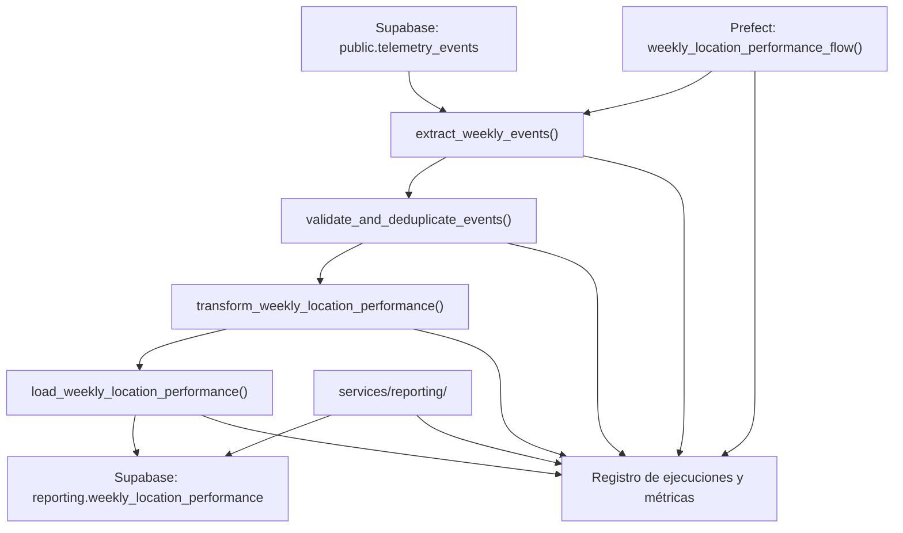

# Diseño del Pipeline de Desempeño de Negocio: Brasaland

**Proyecto:** Brasaland  
**Entregable:** Reporte Semanal de Costo y Merma por Local  
**Fase:** Parte 1 de 3, diseño técnico sin implementación  
**Ubicación:** `data/pipelines/PIPELINE_DESIGN.md`

## 1. Estado actual y problema de negocio

Brasaland opera 14 locales en Colombia y Estados Unidos. Mariana, CEO, y Felipe, director de Operaciones, necesitan un reporte consolidado cada lunes por la mañana para comparar costos de compras, merma y alertas operativas por local.

El monorepo ya cuenta con instrumentación de telemetría en el inventario, almacenamiento de eventos en Supabase mediante `public.telemetry_events` y un reporte técnico disponible en `GET /telemetry/report`.

El reporte técnico actual analiza actividad, errores y latencia de API. No genera indicadores financieros y operativos semanales por local.

Se han identificado en `services/api/routers/inventory.py` los eventos:

- `inbound_order_created`: registro de entrada de inventario.
- `stock_waste_registered`: registro de merma.
- `stock_threshold_triggered`: alerta cuando el inventario cruza hacia abajo el umbral configurado.
- `ingredient_price_variance_detected`: alerta de variación de precio.
- `outbound_order_created`: salida de inventario, útil como contexto, pero no forma parte de los cinco KPI.

**Brecha de datos:** actualmente, los eventos `inbound_order_created` y `stock_waste_registered` incluyen cantidad, moneda y local, pero no incluyen `unit_cost` ni `total_cost`. Por ello, los costos y la proporción de merma no pueden calcularse de forma fiable con los payloads actuales. Esta primera fase documenta el enriquecimiento requerido, sin modificar el código de emisión.

La existencia de emisores de eventos tampoco garantiza que haya datos suficientes en Supabase para todas las semanas y todos los locales. La cobertura debe validarse antes de publicar el reporte como confiable.

## 2. Objetivo y alcance

Diseñar un pipeline semanal que produzca el **Reporte Semanal de Costo y Merma por Local** para Mariana y Felipe, utilizando la telemetría de inventario para calcular cinco KPI: costo total de compras, costo total de merma, proporción de merma, frecuencia de alertas de stock y frecuencia de alertas de variación de precio.

El resultado tendrá una fila por `location_id` y `week_start`, correspondiente al lunes de la semana ISO en UTC.

El diseño contempla:

1. Extracción de eventos desde Supabase.
2. Validación y transformación de datos.
3. Cálculo de los cinco KPI.
4. Carga idempotente en el esquema `reporting`.
5. Orquestación semanal mediante Prefect.
6. Observabilidad, reintentos y recuperación.
7. Contratos de tres endpoints de reporting.

Quedan fuera del alcance de esta primera parte la implementación del flujo, las migraciones, los endpoints, el despliegue y los cambios en los emisores de telemetría.

## 3. KPI y reglas de cálculo

| KPI | Columna de destino | Fuente | Cálculo |
| --- | --- | --- | --- |
| Costo de compras por local | `total_purchase_cost` | `inbound_order_created` | Suma de `total_cost` de compras de la semana |
| Costo de merma por local | `total_waste_cost` | `stock_waste_registered` | Suma de `total_cost` de merma de la semana |
| Proporción de merma | `waste_ratio` | Compras y merma | `total_waste_cost / total_purchase_cost` |
| Frecuencia de alertas de stock | `stockout_events_count` | `stock_threshold_triggered` | Número de eventos únicos de alerta |
| Frecuencia de alertas de precio | `price_alert_events_count` | `ingredient_price_variance_detected` | Número de eventos únicos de alerta |

Reglas:

- Si `total_purchase_cost = 0`, se define `waste_ratio = 0`, evitando división por cero.
- El intervalo semanal es `[week_start 00:00:00 UTC, week_start + 7 días 00:00:00 UTC)`.
- La semana se identifica mediante su lunes ISO en UTC.
- Cada fila conserva `country` y `currency`.
- Colombia utiliza `CO` y `COP`; Estados Unidos utiliza `US` y `USD`.
- No se convierten ni se suman monedas diferentes en esta versión.
- Los conteos representan eventos registrados, no necesariamente incidencias físicas únicas si la instrumentación emite eventos repetidos.
- Una alerta `stock_threshold_triggered` indica el cruce de un umbral de inventario, no necesariamente inventario igual a cero.

### 3.1. Contrato monetario requerido

Los eventos `inbound_order_created` y `stock_waste_registered` deberán incorporar en sus propiedades:

- `unit_cost`: costo monetario unitario del producto.
- `total_cost`: costo total de la operación.
- `quantity`: cantidad involucrada.
- `currency`: `COP` o `USD`.
- `location_id`: identificador del local.
- `country`: `CO` o `US`.
- `order_id`: identificador de la operación.

Se recomienda que el emisor calcule `total_cost = quantity * unit_cost` utilizando el precio correspondiente al momento de la operación, y que envíe ambos valores. El pipeline utilizará `total_cost` como importe canónico y verificará su coherencia con `quantity * unit_cost` cuando ambos estén disponibles.

No se debe utilizar un precio actual para valorar retrospectivamente una merma antigua, porque produciría cifras históricas incorrectas.

Los costos se manejarán como valores decimales exactos, no como números binarios de punto flotante.

No se introducirán nuevos tipos de eventos. Solo se propone enriquecer los tipos existentes.

## 4. Extracción: origen, formato y frecuencia

**Origen:** tabla `public.telemetry_events` de Supabase.

**Formato:** registros de base de datos con metadatos del evento, marca temporal, tipo y propiedades o etiquetas estructuradas. La extracción debe adaptar los nombres reales de columnas al contrato interno del pipeline, sin asumir que las propiedades monetarias ya existen.

Campos lógicos necesarios:

| Campo lógico | Uso |
| --- | --- |
| Identificador único del evento | Deduplicación |
| Marca temporal del evento | Asignación de semana |
| Tipo de evento | Selección del KPI |
| `properties` / `tags` | Atributos de negocio |
| `location_id` | Agrupación por local |
| `country` | Validación geográfica |
| `currency` | Validación monetaria |
| `quantity`, `unit_cost`, `total_cost` | Costos de compras y merma |

Se extraerán únicamente estos cuatro tipos de eventos:

- `inbound_order_created`
- `stock_waste_registered`
- `stock_threshold_triggered`
- `ingredient_price_variance_detected`

`outbound_order_created` queda fuera de los cálculos para evitar contabilizar dos veces la merma.

**Frecuencia programada:** lunes por la mañana, en UTC, una vez finalizada la semana anterior. Hora propuesta: lunes a las 06:00 UTC, sujeta a confirmación operativa de Mariana y Felipe.

También se admitirán ejecuciones manuales y recálculos históricos (*backfill*).

Para una ejecución ordinaria, el intervalo corresponde a la última semana ISO completa, nunca a la semana parcial en curso.

## 5. Arquitectura ETL



### 5.1. Extracción

Función propuesta: `extract_weekly_events(week_start)`.

Responsabilidades:

- Conectarse a Supabase mediante credenciales protegidas.
- Consultar exclusivamente los eventos requeridos.
- Aplicar los límites temporales de la semana.
- Leer resultados paginados para evitar pérdidas por límites de respuesta.
- Registrar número de filas extraídas.
- Distinguir una consulta vacía de un error de conexión.
- No escribir ni modificar `public.telemetry_events`.

### 5.2. Validación y transformación

Funciones propuestas:

- `validate_and_deduplicate_events(events)`
- `transform_weekly_location_performance(events, week_start)`

Responsabilidades:

- Comprobar identificador, fecha, tipo y local.
- Normalizar y validar país y moneda.
- Validar costos no negativos y cantidades válidas.
- Detectar costos ausentes, no numéricos o inconsistentes.
- Deduplicar por identificador único del evento.
- Agrupar por `location_id` y lunes ISO.
- Calcular exactamente los cinco KPI.
- Utilizar aritmética decimal para importes y proporciones.
- Rechazar combinaciones contradictorias de país o moneda para un mismo local y semana.

**Política de calidad:** no sustituir importes monetarios desconocidos por cero. Los registros inválidos se contabilizan y se documentan. Si impiden obtener un agregado financiero completo, la ejecución de esa semana se marca como fallida o no publicable, conservando el último resultado válido. Un cero real debe diferenciarse de un costo desconocido.

Para locales sin eventos, no se inventarán filas con ceros sin un catálogo autorizado de los 14 locales y una confirmación de cobertura de captura.

### 5.3. Carga

Función propuesta: `load_weekly_location_performance(rows, week_start)`.

Responsabilidades:

- Escribir únicamente en `reporting.weekly_location_performance`.
- Utilizar una transacción para publicar una semana completa.
- Aplicar `UPSERT` sobre `(location_id, week_start)`.
- Actualizar `computed_at` en cada recálculo.
- Evitar duplicados por reintentos.
- Garantizar que un fallo no deje una semana parcialmente publicada.

Para recálculos completos, la carga debe reconciliar las filas previamente publicadas para esa semana, eliminando de forma transaccional únicamente las filas obsoletas de esa semana, si procede. Esto evita conservar resultados de eventos corregidos o retirados.

## 6. Modelo de datos de destino

La tabla de destino definida por el BRIEFING es:

```sql
create table reporting.weekly_location_performance (
  id uuid primary key default gen_random_uuid(),
  location_id text not null,
  country text not null,
  week_start date not null,
  total_purchase_cost numeric not null default 0,
  total_waste_cost numeric not null default 0,
  waste_ratio numeric not null default 0,
  stockout_events_count integer not null default 0,
  price_alert_events_count integer not null default 0,
  currency text not null,
  computed_at timestamptz not null default now(),
  unique (location_id, week_start)
);
```

El esquema `reporting` deberá existir antes de ejecutar la migración en una fase posterior.

La restricción `unique (location_id, week_start)` garantiza una sola fila por local y semana.

Ejemplo conceptual de carga:

```sql
insert into reporting.weekly_location_performance (
  location_id,
  country,
  week_start,
  total_purchase_cost,
  total_waste_cost,
  waste_ratio,
  stockout_events_count,
  price_alert_events_count,
  currency,
  computed_at
)
values (
  :location_id,
  :country,
  :week_start,
  :total_purchase_cost,
  :total_waste_cost,
  :waste_ratio,
  :stockout_events_count,
  :price_alert_events_count,
  :currency,
  now()
)
on conflict (location_id, week_start)
do update set
  country = excluded.country,
  total_purchase_cost = excluded.total_purchase_cost,
  total_waste_cost = excluded.total_waste_cost,
  waste_ratio = excluded.waste_ratio,
  stockout_events_count = excluded.stockout_events_count,
  price_alert_events_count = excluded.price_alert_events_count,
  currency = excluded.currency,
  computed_at = now();
```

El SQL anterior ilustra el `UPSERT` por fila. En producción, todas las operaciones correspondientes a una semana deberán ejecutarse en una misma transacción, con control de concurrencia y reconciliación del conjunto semanal.

## 7. Idempotencia, eventos tardíos y backfill

### 7.1. Duplicados en origen

Cada evento debe disponer de un identificador estable y único en su envoltorio de telemetría.

La deduplicación se hará por ese identificador, no por `event_type`, `location_id` o fecha, porque dos operaciones legítimas pueden compartir esos valores.

Si el cliente reintenta enviar un evento, debe reutilizar el mismo identificador lógico. El receptor debe aplicar una restricción de unicidad o mecanismo equivalente para impedir inserciones duplicadas.

### 7.2. Reintentos y cargas parciales

El flujo podrá repetirse sin duplicar resultados porque:

- Se recalcula la semana completa desde la fuente.
- La tabla de destino tiene una clave única por local y semana.
- La publicación se realiza en una transacción.
- Un fallo provoca `ROLLBACK`.
- Un reintento vuelve a calcular y publicar el resultado completo.

No se sumarán incrementalmente costos sobre resultados anteriores.

### 7.3. Eventos tardíos

Los eventos recibidos después de la ejecución del lunes se asignarán a la semana correspondiente a su marca temporal de negocio, siempre que esta sea válida y verificable.

La estrategia propuesta es recalcular la semana anterior en cada ejecución ordinaria y programar una ventana adicional de revisión de semanas recientes. El período exacto de revisión deberá acordarse con Operaciones según la latencia observada.

También se permitirá ejecutar manualmente un recálculo para cualquier semana histórica válida.

### 7.4. Concurrencia

Las ejecuciones automáticas y manuales podrían coincidir.

Se aplicará un bloqueo por `week_start` mediante un mecanismo transaccional de base de datos o equivalente. Dos procesos no podrán publicar simultáneamente la misma semana.

Si el bloqueo está ocupado, la segunda ejecución esperará o finalizará con un estado controlado y registrable.

## 8. Orquestación con Prefect

Flujo propuesto:

`weekly_location_performance_flow(week_start=None)`

Tareas principales:

1. `extract_weekly_events_task`: consulta Supabase.
2. `validate_transform_events_task`: valida, deduplica y calcula KPI.
3. `load_weekly_performance_task`: publica el resultado en la tabla de reporting.

Se podrá separar la validación en una cuarta tarea para mejorar la observabilidad.

Estados principales:

| Estado | Significado |
| --- | --- |
| `Running` | Ejecución en curso |
| `Completed` | Semana validada y publicada correctamente |
| `Failed` | Error de extracción, calidad, transformación o carga |

La configuración de Prefect incluirá:

- Despliegue semanal los lunes a las 06:00 UTC.
- Ejecución manual con parámetro `week_start`.
- Reintentos limitados con espera exponencial para errores transitorios.
- Límites de concurrencia por semana.
- Notificaciones de fallos.
- Bloques o almacenamiento seguro para credenciales de Supabase y configuración del entorno.

Las credenciales no se incluirán en el repositorio, los logs ni el documento.

## 9. Observabilidad y auditoría

Se propone mantener un registro de ejecuciones separado de `public.telemetry_events`, mediante Prefect y, si se requiere consulta desde la API, un registro persistente de reporting.

Campos mínimos:

| Campo | Tipo | Propósito |
| --- | --- | --- |
| `run_id` | UUID o texto | Identificar cada ejecución |
| `week_start` | date | Identificar la semana procesada |
| `source_window_start` | timestamptz | Límite inicial de extracción |
| `source_window_end` | timestamptz | Límite final exclusivo |
| `started_at` | timestamptz | Medir inicio y duración |
| `finished_at` | timestamptz nullable | Detectar ejecuciones inconclusas |
| `status` | texto | `Running`, `Completed` o `Failed` |
| `events_extracted` | integer | Medir volumen de origen |
| `events_valid` | integer | Medir cobertura utilizable |
| `events_duplicate` | integer | Detectar reenvíos |
| `events_invalid` | integer | Detectar problemas de calidad |
| `rows_loaded` | integer | Comprobar resultados publicados |
| `error_message` | texto nullable | Facilitar diagnóstico |
| `trigger_type` | texto | Distinguir cron, manual y backfill |

Se registrarán también métricas de duración, cantidad de locales cubiertos, eventos por tipo y proporción de registros con costos ausentes.

### 9.1. Distinguir cero actividad de fallo

- **Consulta exitosa con cero eventos:** resultado técnicamente válido, pero requiere verificación de cobertura antes de publicar ceros.
- **Consulta fallida:** estado `Failed`, sin reemplazar datos anteriores.
- **Eventos presentes pero faltan costos:** fallo de calidad de datos para los KPI financieros.
- **Faltan locales esperados:** alerta de cobertura, utilizando un catálogo validado de los 14 locales.
- **Volumen inesperadamente bajo:** alerta por desviación respecto de semanas anteriores.

Una ejecución no se considerará exitosa únicamente porque la consulta SQL haya terminado sin errores.

## 10. API de reporting prevista

La implementación futura se ubicará en `services/reporting/`, reutilizando funciones de `data/pipelines/`. No se modificará el endpoint existente `GET /telemetry/report`.

### 10.1. Consultar desempeño semanal

`GET /reporting/weekly-location-performance?week_start=YYYY-MM-DD`

- `week_start` opcional.
- Si no se proporciona, se utiliza la última semana ISO completa.
- Se valida que la fecha sea lunes.
- Consulta resultados ya calculados, sin ejecutar ETL en cada solicitud.
- Devuelve una lista de locales y los cinco KPI.

Ejemplo ilustrativo, no basado en resultados reales:

```json
{
  "week_start": "2026-07-13",
  "locations": [
    {
      "location_id": "medellin-centro",
      "country": "CO",
      "total_purchase_cost": 8420000,
      "total_waste_cost": 610000,
      "waste_ratio": 0.072,
      "stockout_events_count": 2,
      "price_alert_events_count": 1,
      "currency": "COP"
    }
  ]
}
```

Función de acceso propuesta: `get_weekly_location_performance(week_start)`.

### 10.2. Consultar última ejecución

`GET /reporting/pipeline-runs/latest`

Devuelve el estado de la última ejecución, identificador, período, fechas de inicio y fin, volúmenes procesados y mensaje de error cuando corresponda.

Función propuesta: `get_latest_pipeline_run()`.

### 10.3. Iniciar ejecución manual

`POST /reporting/pipeline-runs`

Permite iniciar una ejecución para una semana específica, previa autenticación y autorización.

Función propuesta: `trigger_weekly_location_performance_flow(week_start)`.

La respuesta debe incluir un identificador de ejecución para consultar su estado. El procesamiento se realizará de forma asíncrona, sin mantener abierta la solicitud HTTP durante todo el ETL.

### 10.4. Separación de responsabilidades y mapeo de endpoints

Los siguientes archivos y funciones son propuestas de diseño para las fases posteriores. **Todavía no están implementados.**

| Endpoint en `services/reporting/` | Función en `data/pipelines/` | Responsabilidad |
| --- | --- | --- |
| `GET /reporting/weekly-location-performance` | `reporting_queries.py` → `get_weekly_location_performance(week_start)` | Consultar los KPI semanales ya publicados, sin ejecutar el ETL. |
| `GET /reporting/pipeline-runs/latest` | `run_registry.py` → `get_latest_pipeline_run()` | Consultar el estado y los datos de auditoría de la última ejecución. |
| `POST /reporting/pipeline-runs` | `orchestration.py` → `trigger_weekly_location_performance_flow(week_start)` | Solicitar una ejecución asíncrona del flujo de Prefect y devolver su identificador. |

**Distribución prevista de responsabilidades:**

- `data/pipelines/extract.py`: extracción paginada mediante `extract_weekly_events()`.
- `data/pipelines/transform.py`: validación, deduplicación y transformación de eventos.
- `data/pipelines/load.py`: carga transaccional e idempotente mediante `load_weekly_location_performance()`.
- `data/pipelines/orchestration.py`: flujo y tareas de Prefect, además de la activación manual.
- `data/pipelines/reporting_queries.py`: consultas de los KPI publicados.
- `data/pipelines/run_registry.py`: consultas del registro de ejecuciones.
- `data/process/`: funciones reutilizables de limpieza, validación y agregación.
- `services/reporting/`: endpoints HTTP, autenticación, autorización y serialización. Reutiliza las funciones de `data/pipelines/`.
- `public.telemetry_events`: origen de solo lectura.
- `reporting.weekly_location_performance`: tabla de resultados consolidados.

La dependencia va desde `services/reporting/` hacia `data/pipelines/`, nunca al contrario. Se mantienen intactos `services/telemetry/analysis.py` y `GET /telemetry/report`.

## 11. Fallos y escenarios operativos

| Escenario | Estrategia |
| --- | --- |
| Duplicados en la fuente | Deduplicar por identificador único del evento |
| Reintento después de carga parcial | Transacción, rollback y recálculo completo |
| Eventos que llegan tarde | Reprocesar semanas recientes y permitir backfill |
| Ausencia silenciosa de eventos | Comprobar cobertura, volúmenes y locales esperados |
| Pérdida de conexión con Supabase | Reintentos limitados, alerta y estado `Failed` |
| Crecimiento del volumen | Paginación, índices, procesamiento por ventanas y seguimiento de duración |
| Caída inesperada del volumen | Comparación histórica y alerta de calidad |
| Frontend sin conexión | Buffer local persistente y reenvío con identificador estable |
| Reintento de `POST` de telemetría | Clave de idempotencia para evitar eventos duplicados |
| Cron y ejecución manual simultáneos | Bloqueo por semana y publicación transaccional |
| Costos ausentes | No inventar ceros; bloquear publicación financiera incompleta |
| País o moneda inconsistentes | Validar y rechazar agregados ambiguos |

### 11.1. Trazabilidad de la captura

La trazabilidad debe cubrir:

1. Operación de inventario en el backend.
2. Creación del evento y su identificador estable.
3. Envío al receptor de telemetría.
4. Confirmación de persistencia en `public.telemetry_events`.
5. Extracción y validación por el pipeline.
6. Publicación del agregado semanal.

Para detectar pérdidas, se compararán conteos por etapa y se registrarán rechazos, reintentos y errores. La comparación entre operaciones de inventario y eventos persistidos ayudará a distinguir ausencia real de actividad de fallos de captura.

El buffer offline aplica a eventos generados por clientes que dependan de conectividad. Los eventos generados por el backend requerirán una estrategia equivalente de entrega fiable, como una cola persistente o patrón outbox, si se exige garantía de entrega.

## 12. Seguridad y operación

- Usar credenciales de Supabase almacenadas en secretos o bloques seguros.
- Conceder permisos mínimos: lectura de telemetría y escritura controlada en reporting.
- Restringir la activación manual a usuarios autorizados.
- No exponer credenciales ni payloads sensibles en logs.
- Registrar errores sin información secreta.
- Mantener separadas las responsabilidades de telemetría y reporting.
- Documentar la configuración de ejecución para desarrollo, pruebas y producción en las fases de implementación.

## 13. Plan de validación para las siguientes fases

Antes de considerar operativo el pipeline se deberán probar:

1. Semana con compras, merma y alertas de los dos tipos.
2. Semana con compras y sin merma.
3. Semana sin compras, verificando `waste_ratio = 0`.
4. Eventos duplicados con el mismo identificador.
5. Eventos tardíos que modifican una semana ya calculada.
6. Costos faltantes o inconsistentes.
7. País y moneda incompatibles.
8. Fallo de conexión durante extracción.
9. Fallo de carga y rollback.
10. Dos ejecuciones concurrentes para la misma semana.
11. Reejecución idempotente sin duplicar filas.
12. Semana sin actividad y detección de cobertura insuficiente.
13. Reprocesamiento histórico de una semana.
14. Respuesta correcta de los tres endpoints previstos.

Los datos de prueba deberán cubrir locales de Colombia y Estados Unidos, respetando sus monedas.

## 14. Decisiones pendientes y riesgos

| Riesgo o decisión | Impacto | Acción propuesta |
| --- | --- | --- |
| Eventos sin costo monetario | No permite calcular tres KPI | Enriquecer `inbound_order_created` y `stock_waste_registered` |
| Cobertura insuficiente de eventos | Reportes incompletos | Medir captura y calidad antes de publicar |
| Falta de catálogo autorizado de 14 locales | No permite distinguir locales sin actividad de locales sin captura | Integrar catálogo de locales en una fase posterior |
| Retraso de eventos | Modifica semanas cerradas | Reprocesamiento y backfill |
| Duplicados por reintentos | Sobreconteo | Identificador estable e idempotencia |
| Hora de entrega del lunes | Afecta disponibilidad para Dirección | Confirmar ventana operativa y zona horaria |
| Variaciones de moneda o país | Agregados incorrectos | Validación estricta y sin conversión en v1 |

## 15. Criterios de aceptación del diseño

El diseño se considerará completo cuando:

- Defina el objetivo de negocio y los cinco KPI.
- Identifique los eventos y el almacenamiento de origen.
- Explique la brecha monetaria actual.
- Incluya diagrama ETL y responsabilidades.
- Defina la tabla de destino y su clave única.
- Documente idempotencia, eventos tardíos y backfill.
- Describa Prefect, tareas, estados y programación.
- Incluya observabilidad y detección de fallos silenciosos.
- Defina los tres endpoints previstos.
- Distinga claramente diseño de implementación.
- Mantenga intactos el reporte técnico de telemetría y sus componentes.

---

**Estado:** Diseño propuesto. No implementado.

**Siguiente fase:** validar los contratos monetarios, implementar y probar el pipeline, y configurar su orquestación.
